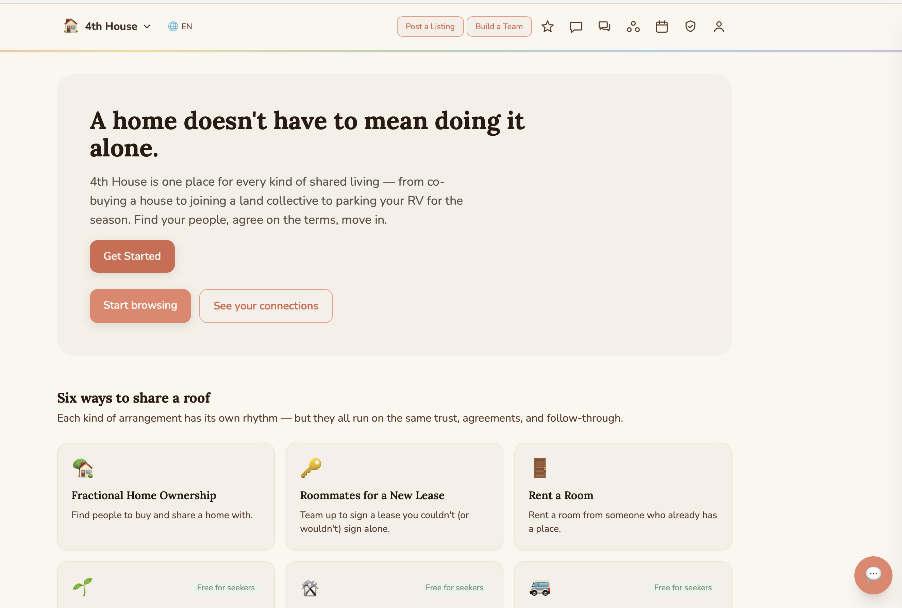
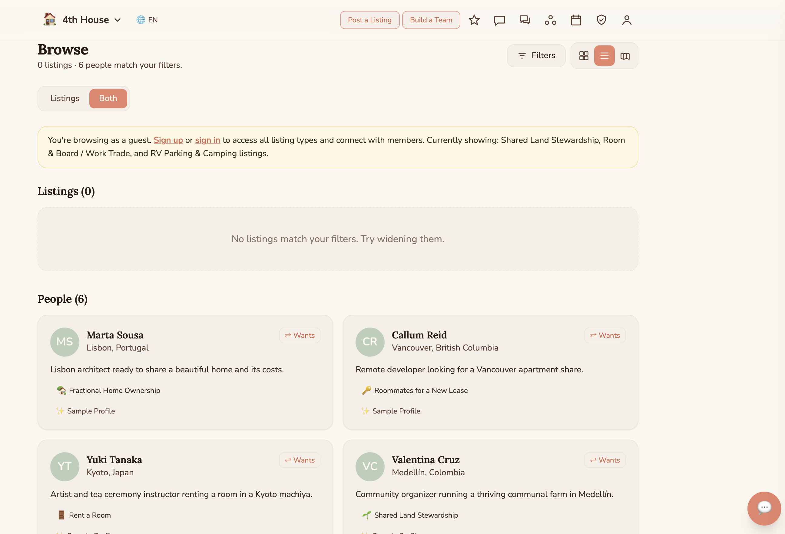
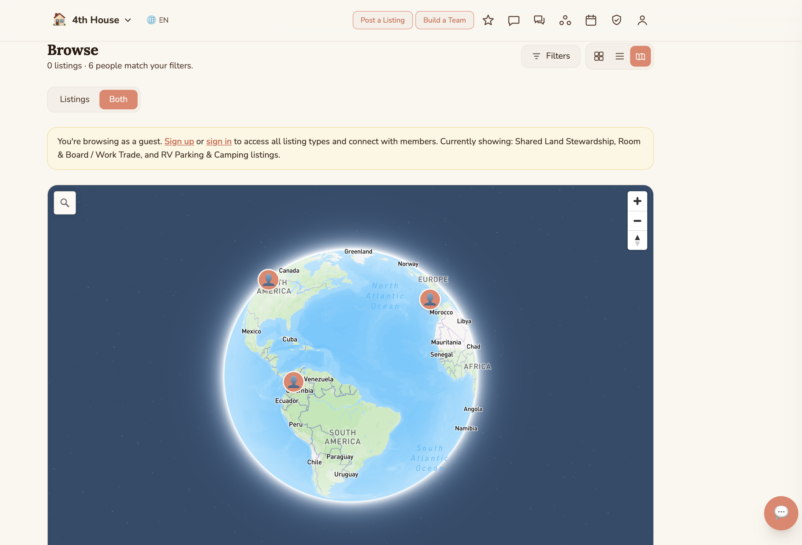
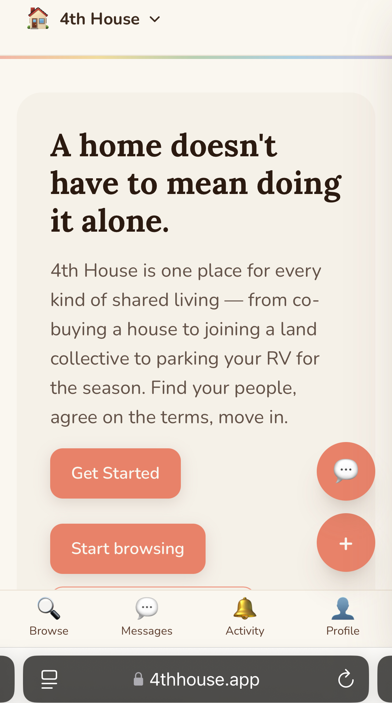
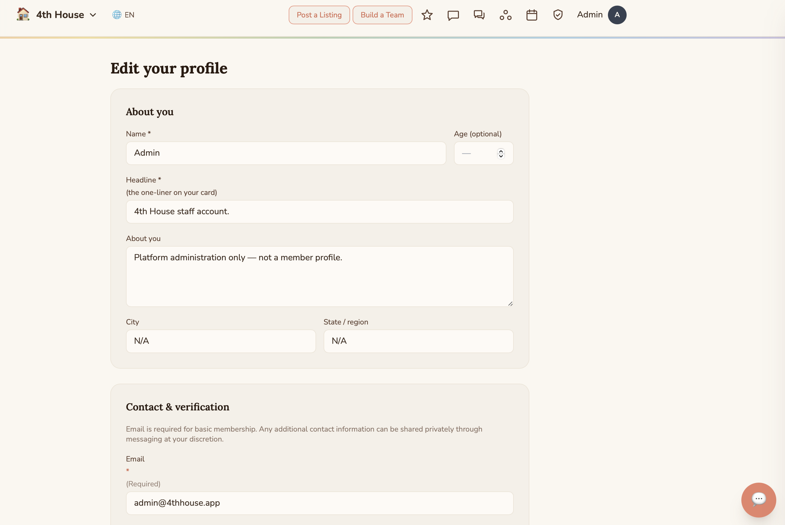

# portfolio
Web development portfolio — custom applications and platforms.
# Aexis Liester — Web Developer Portfolio

## About Me
After 14 years in property management and real estate, 
I built a full-stack web platform from scratch. 
I now build custom web applications and websites 
for founders and businesses ready to show up online.

---

## Featured Project — 4th House
**Live site:** [4thhouse.app](https://4thhouse.app)

4th House is a shared living lifestyle platform 
connecting people interested in shared living 
arrangements across six categories.

### What I Built
- User authentication (Clerk)
- Real-time database (Convex)
- Payment processing (Stripe)
- Interactive map view (Mapbox)
- Email notifications (Resend)
- AI-powered help bot (Claude API)
- Admin dashboard
- Mobile responsive design
- Full production deployment (Vercel)

### Tech Stack
- Next.js + React
- TypeScript
- Tailwind CSS
- Convex (real-time database)
- Clerk (authentication)
- Stripe (payments)
- Mapbox (maps)
- Resend (email)
- Anthropic API (AI)
- Vercel (hosting)

---

## Services I Offer
Custom websites and web applications — 
from landing pages to full platforms.

**Contact:** admin@4thhouse.app

---

## Screenshots

### Home Page

### Browse View

### Map View

### Mobile View

### Profile Builder

---

*All work is original and custom coded. 
No templates were used.*
